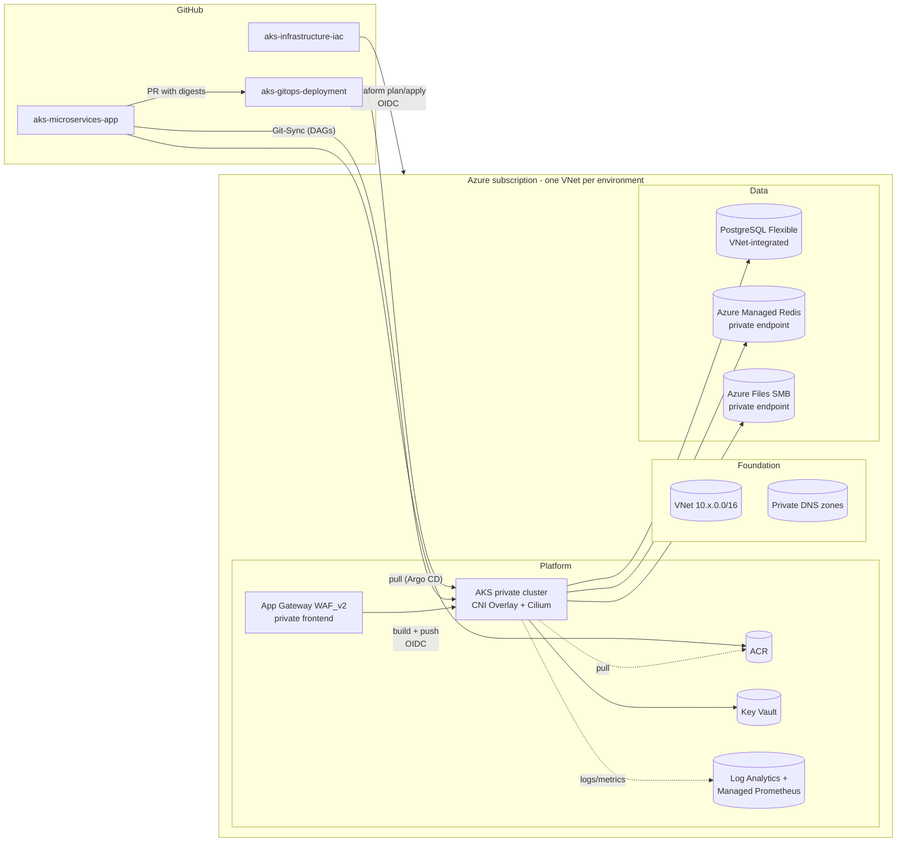
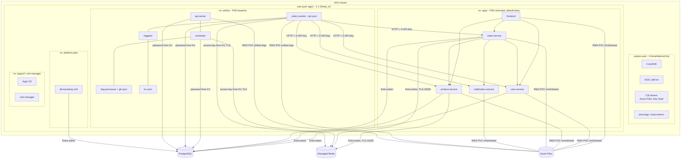
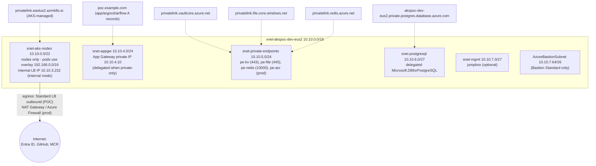
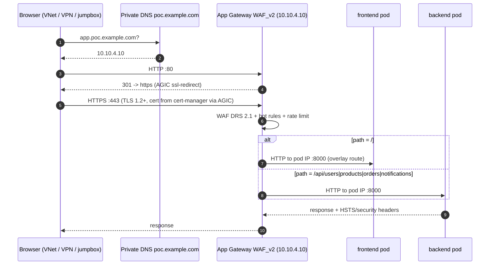
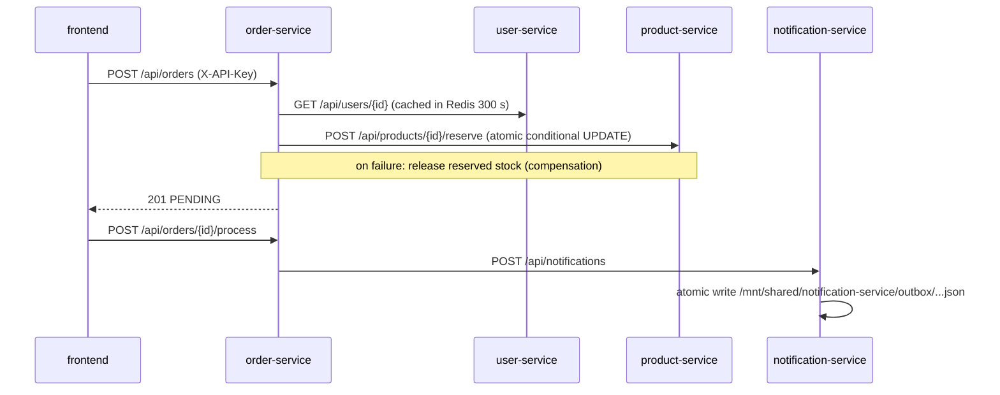
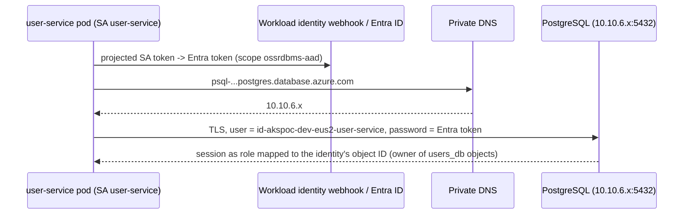

# Architecture

Azure AKS enterprise POC: private AKS, managed data services, GitOps delivery.
All diagrams are Mermaid (rendered by GitHub).

## 1. Ownership boundaries

| Layer | Owner | Tool | Repository | Examples |
|---|---|---|---|---|
| Azure resources | Platform team | Terraform (GitHub Actions + OIDC) | `aks-infrastructure-iac` | VNet, AKS, App Gateway, ACR, Key Vault, PostgreSQL, Managed Redis, Storage, identities, RBAC, monitoring |
| Secret values | Terraform (generated) / operators (external) | ARM control plane, `set-operator-secret.sh` | none (Key Vault only) | DB password, broker URL, Fernet key, deploy keys, OAuth secret |
| Kubernetes resources | Argo CD | Helm charts + values | `aks-gitops-deployment` | namespaces, policies, PV/PVC, Airflow, the five services, Ingress, certificates |
| Images and DAGs | Application teams | GitHub Actions (CI only, no AKS access) | `aks-microservices-app` | service images, Airflow image, db-bootstrap image, DAG files |
| DAG delivery | Airflow Git-Sync | git (SSH deploy key, read-only) | `aks-microservices-app/airflow/dags` | DAG files only |

Rules that keep the boundaries clean:

- Terraform never talks to the Kubernetes API (the API server is private; no Helm/Kubernetes providers). Argo CD is bootstrapped once by `argocd/bootstrap/install.sh`.
- Argo CD never creates Azure resources. Azure facts reach Git through a generated, non-secret contract file (`environments/<env>/infrastructure.yaml`, produced by `scripts/export-gitops-values.sh`).
- CI never deploys. It pushes immutable images and opens a pull request in the GitOps repo; merging that PR is the deployment approval.
- Terraform owns the Azure Files shares; Kubernetes binds to them with static PersistentVolumes (no dynamic provisioning of the same share).
- Terraform creates the PostgreSQL server; databases, roles and grants are SQL in a versioned Job (`db-bootstrap`), because ARM-created databases are owned by an internal role.

## 2. High-level design



## 3. Low-level design (in-cluster)



## 4. Azure network topology



Every subnet has `default_outbound_access_enabled = false`; NSGs deny VNet-wide
traffic except the explicitly allowed paths (see [network-design.md](network-design.md)).

## 5. Traffic flows

### 5.1 User to application (HTTPS)



AGIC programs listeners, path maps and health probes (from each pod's readiness
probe) from the Kubernetes `Ingress`. Individual services are `ClusterIP` only.
The optional public WAF frontend (`appgw_public_frontend_enabled`, prod) binds
only the application hostname; admin hostnames always use the private IP.

### 5.2 Application to application



Kubernetes DNS (`<svc>.apps.svc.cluster.local`), plain HTTP inside the cluster,
NetworkPolicy allow-lists per callee, API key for writes. Production upgrade:
mTLS (Istio add-on) and Entra-issued tokens instead of a shared key.

### 5.3 Application to PostgreSQL



### 5.4 Application to Redis

`product-service` and `order-service` authenticate with Entra ID (redis-entraid
credential provider, background token refresh) over TLS to
`<name>.eastus2.redis.azure.net:10000`, which resolves to the private endpoint.
Keys are namespaced `app:<service>:...` and always set with a TTL. Airflow uses
the same instance with the access key (`airflow:` prefix).

### 5.5 Application to Azure Files

The kubelet identity mounts `//<account>.file.core.windows.net/shared-files`
(private endpoint, SMB 3.1.1, AES-GCM, Kerberos/SMB OAuth) once per node; pods on
any node see the same files at `/mnt/shared`. See [shared-storage.md](shared-storage.md).

### 5.6 Airflow to application

Celery workers (namespace `airflow`) call `http://<svc>.apps.svc.cluster.local:8000`
through Airflow HTTP connections; the `X-API-Key` header comes from the Key Vault
secret `internal-api-key`. Allowed by the `airflow` egress policy and each
service's `allowFromAirflow` ingress rule.

### 5.7 Administrator to AKS API

```mermaid
flowchart LR
  A[Administrator] -->|1. az aks command invoke<br/>ARM, no network path| ARM[(Azure Resource Manager)] --> API[Private API server]
  A -->|2. Bastion -> jumpbox in snet-mgmt| J[jumpbox] -->|kubectl + kubelogin, Entra| API
  A -->|3. VPN / ExpressRoute / peered hub (production)| API
```

Authentication is Entra ID (kubelogin); local accounts are disabled.
Authorization is Azure RBAC for Kubernetes plus Kubernetes RBAC RoleBindings.

### 5.8 CI/CD to Azure

GitHub Actions authenticate to Entra ID with OIDC federated credentials:

| Workflow | Identity | Federated subject | Permissions |
|---|---|---|---|
| terraform-plan | `id-akspoc-github-tf-<env>-plan` | `repo:<org>/aks-infrastructure-iac:pull_request` | Reader + state blob lock |
| terraform-apply | `id-akspoc-github-tf-<env>-apply` | `...:environment:<env>` | Contributor + constrained RBAC admin + state |
| build (app) | `id-akspoc-dev-eus2-github-acr` | `repo:<org>/aks-microservices-app:ref:refs/heads/main` | AcrPush (dev ACR) |
| promote (app) | `id-akspoc-<env>-eus2-github-acr` | `...:environment:<env>` | AcrPush target + AcrPull source |
| GitOps PR | GitHub App (no Azure) | — | contents/pull-requests on the GitOps repo |

No Azure identity can reach the Kubernetes API from CI.

## 6. Ingress and routing

| Host | Path | Backend | Frontend IP | Auth |
|---|---|---|---|---|
| `app.poc.example.com` | `/` | `frontend:8000` | private (public optional) | none (demo) / CSRF on forms |
| `app.poc.example.com` | `/api/users` | `user-service:8000` | same | API key for writes |
| `app.poc.example.com` | `/api/products` | `product-service:8000` | same | API key for writes |
| `app.poc.example.com` | `/api/orders` | `order-service:8000` | same | API key for writes |
| `app.poc.example.com` | `/api/notifications` | `notification-service:8000` | same | API key for writes |
| `argocd.poc.example.com` | `/` | `argocd-server:80` | private only | Entra SSO (workload identity) |
| `airflow.poc.example.com` | `/` | `airflow-api-server:8080` | private only | Entra SSO (FAB OAuth, app roles) |

Services serve their full prefix, so no path rewrite is needed. Both ingress
modes are selected by one setting each in Terraform (`ingress_mode`) and GitOps
(`ingressMode`, `global.ingress.mode`); never both:

| | `agic` (default) | `internal` (low cost) |
|---|---|---|
| Edge | Application Gateway WAF_v2 (or Standard_v2) | Traefik v3 behind internal Standard LB |
| WAF | DRS 2.1, bot manager, rate limit | none (add WAF upstream if needed) |
| TLS | cert-manager secret uploaded by AGIC; TLS policy 2022 | cert-manager secret at Traefik |
| Redirect / HSTS | AGIC annotation / app headers | entrypoint redirect / Middleware |
| Fixed cost | App Gateway hourly fee | 2 small pods + LB rule |
