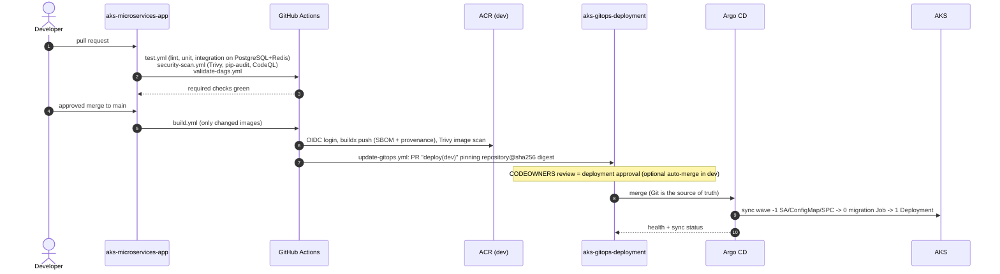
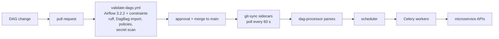

# CI/CD and GitOps

## Application pipeline

Promotion to test/prod: run `update-gitops.yml` manually with the digest that is
running in the lower environment. Inside the protected GitHub environment, the
image is copied **by digest** (`crane copy`, byte-identical) into the target
registry and a PR is opened for that environment. Nothing is rebuilt.

## Infrastructure pipeline

See [terraform.md](terraform.md#cicd).

## DAG pipeline

## Argo CD design

- **App-of-apps**: `root` (installed by `argocd/bootstrap/install.sh`) renders
  `argocd/applications` with `environments/<env>/argocd.yaml`.
- **AppProjects**: `platform` (cluster-scoped allow list, platform namespaces),
  `apps` (namespace `apps` only, GitOps repo only, no cluster resources, no RBAC,
  quotas or Ingress), `airflow` (namespace `airflow`, Airflow chart repo).
- **ApplicationSet** `microservices`: list generator over the five services;
  `preserveResourcesOnDeletion: true`.
- **Sync waves** (child Application health restored with a Lua health check):

| Wave | Applications |
|---|---|
| -25 | argocd (self-management, manual sync only) |
| -20 | argocd-projects |
| -15 | namespaces (PSS labels, quotas, limit ranges) |
| -14 | security-policies, rbac, network-policies |
| -13 | cert-manager |
| -12 | storage (static PV/PVC), platform-secrets (Key Vault -> Airflow secrets) |
| -10 | db-bootstrap (databases, roles, grants) |
| -9 | traefik (internal mode only) |
| -8 | platform-ingress (issuers, certificates, Ingress), platform-monitoring |
| 0 | airflow, microservices |

- **Sync policy per environment**: dev automated + prune + self-heal; test
  automated + self-heal, no prune; prod manual sync inside a sync window
  (weekdays 08:00-18:00 UTC), manual sync allowed for emergencies.
- Namespaces and PVs carry `Prune=false,Delete=false` so they are never removed
  by a pruning sync.

### Rollback

1. Revert the deployment PR in `aks-gitops-deployment` (preferred; auditable).
2. Emergency: `argocd app rollback <app> <history-id>` (automated sync is paused
   for that app until Git matches again).
3. Migrations are forward-only; write a new migration to undo schema changes.

### Drift detection

Change something by hand (`kubectl -n apps scale deploy user-service --replicas=3`).
In dev/test, self-heal reverts it within seconds; in prod the application shows
`OutOfSync` until someone syncs. `argocd app diff <app>` shows the drift.

## Git-Sync vs Argo CD

| | Argo CD | Airflow Git-Sync |
|---|---|---|
| What | Kubernetes manifests (Helm) | DAG Python files |
| Source | `aks-gitops-deployment` | `aks-microservices-app/airflow/dags` |
| Mechanism | reconciles desired state via the API server | sidecar `git pull` into a shared emptyDir per pod |
| Approval point | GitOps PR | application PR (validate-dags) |
| Dependencies | images by digest | none (packages and plugins are in the Airflow image) |
| Rollback | revert PR / `argocd app rollback` | revert DAG commit, or pin `dags.gitSync.ref` to a SHA |
