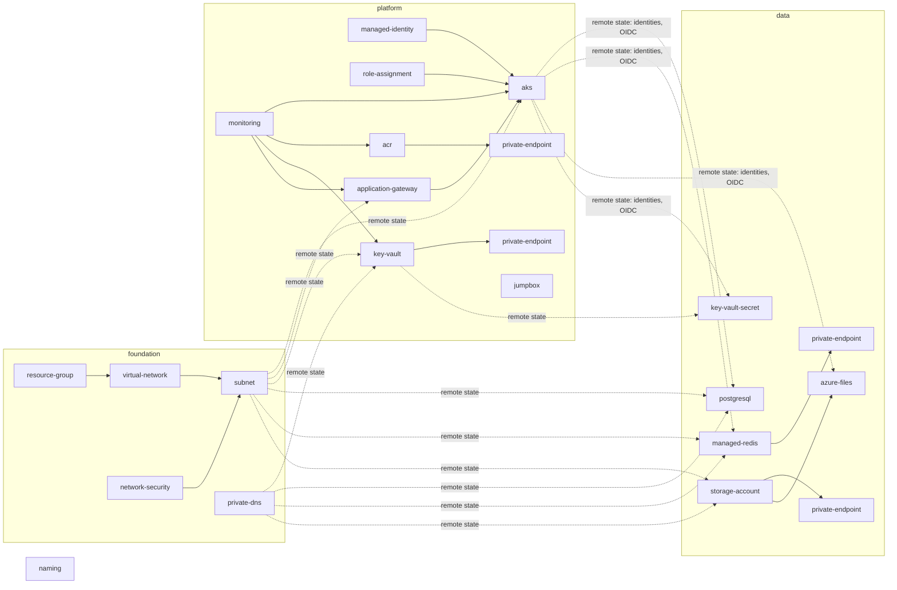
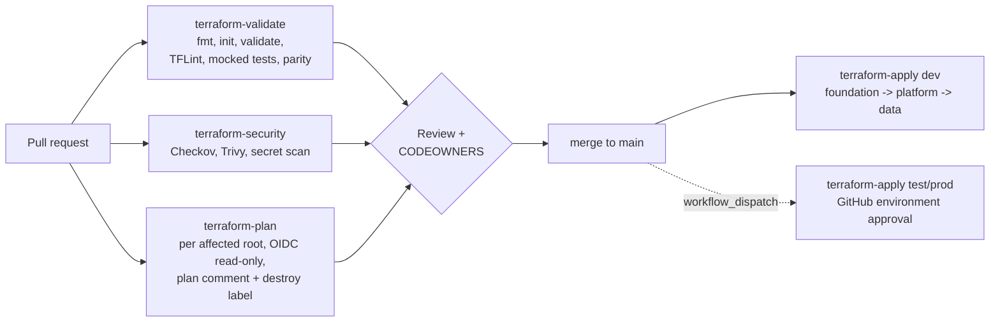

# Terraform design

## Layout

```
modules/           reusable, provider-agnostic of environment (no provider blocks)
environments/
  <env>/foundation  resource groups, VNet, subnets, NSGs, NAT, private DNS
  <env>/platform    monitoring, identities, ACR, Key Vault, App Gateway, AKS, RBAC, DNS records, jumpbox
  <env>/data        PostgreSQL, Managed Redis, Storage + Azure Files, Key Vault secrets, data RBAC
bootstrap/terraform-backend   state account, containers, GitHub OIDC identities (local state, then migrated)
bootstrap/entra               persona groups and SSO app registrations (Entra admin, az CLI)
```

Root code is **identical** across environments (enforced by
`scripts/check-env-parity.sh` in CI); only `terraform.tfvars` and `backend.hcl` differ.

## Module dependency graph



## State separation

| Container | Key | Contents | Blast radius |
|---|---|---|---|
| `tfstate-<env>` | `foundation.tfstate` | network | rarely changes; locked in prod |
| `tfstate-<env>` | `platform.tfstate` | AKS & co | cluster lifecycle |
| `tfstate-<env>` | `data.tfstate` | stateful data services + secrets | most sensitive |

Dependencies are one-way (foundation -> platform -> data) through
`terraform_remote_state` (read-only outputs). No layer writes to another layer's
resources, except the platform layer adding A records to the foundation-owned
private DNS zone (separate resources, no shared ownership).

## Backend security and recovery

- Storage account: Entra-only (`shared_access_key_enabled = false`), TLS 1.2,
  RA-GRS, `CanNotDelete` lock, blob **versioning**, **change feed**, **soft delete
  (30 d)** for blobs and containers, **point-in-time restore (29 d)**.
- One container per environment; pipeline identities are scoped to their
  container (dev pipeline cannot read prod state).
- Locking: native blob lease. Break a stuck lock only after confirming no run is
  active: `terraform force-unlock <id>`.
- Restore a corrupted state: list versions
  `az storage blob list --account-name <st> -c tfstate-dev --include v --prefix platform.tfstate --auth-mode login`,
  then promote a version (`az storage blob copy start --source-uri "<url>?versionid=<id>"`),
  run `terraform plan` and verify no unexpected changes.
- Secrets in state: the Redis access key and generated passwords are in state
  (marked sensitive). The PostgreSQL admin password is *not* (ephemeral + write-only).

## Refactoring without destroying resources

Use `moved` blocks (preferred, reviewable in the plan) or `terraform state mv`:

```hcl
moved {
  from = module.subnet["snet-aks"]
  to   = module.subnet["snet-aks-nodes"]
}
```

Import existing resources with `import` blocks. Plans must show `0 to destroy`
for a pure refactor; the apply workflow's destroy guard enforces this.

## Destructive changes

1. Pull request shows the plan; a destroy adds the `terraform-destroy` label.
2. `terraform-apply` fails on any delete unless `allow_destroy = true`.
3. Deleting stateful types (PostgreSQL, Redis, storage accounts/shares, Key
   Vault, ACR, AKS, VNet, DNS zones) additionally requires
   `confirm_protected_destroy = <env>/<layer>`.
4. Production also has resource-group locks (remove deliberately first) and
   GitHub environment reviewers.
5. Before destroying data: take a PostgreSQL backup/export, snapshot shares,
   confirm Key Vault soft-delete/purge protection implications.

## CI/CD



GitHub configuration (per repository):

| Kind | Name | Value |
|---|---|---|
| repo variable | `AZURE_TENANT_ID` | tenant |
| repo variable | `AZURE_SUBSCRIPTION_ID_<ENV>` | subscription per env |
| repo variable | `AZURE_CLIENT_ID_PLAN_<ENV>` | bootstrap output `github_identities["<env>-plan"]` |
| environment `<env>` variable | `AZURE_CLIENT_ID`, `AZURE_SUBSCRIPTION_ID` | apply identity |
| environment protection | `test`, `prod` | required reviewers, deployment branch `main` |
| branch protection | `main` | PR required, validate/security/plan checks required, CODEOWNERS |

## Version constraints

- Terraform `>= 1.11.0, < 2.0.0` (write-only attributes, ephemeral resources, `terraform test` mocks). Tested with 1.17.1.
- AzureRM `~> 5.13` in roots, `>= 5.0, < 6.0` in modules. Tested with 5.13.0.
- `random ~> 3.9`. Provider lock files committed for linux_amd64, darwin_amd64, darwin_arm64, windows_amd64.
